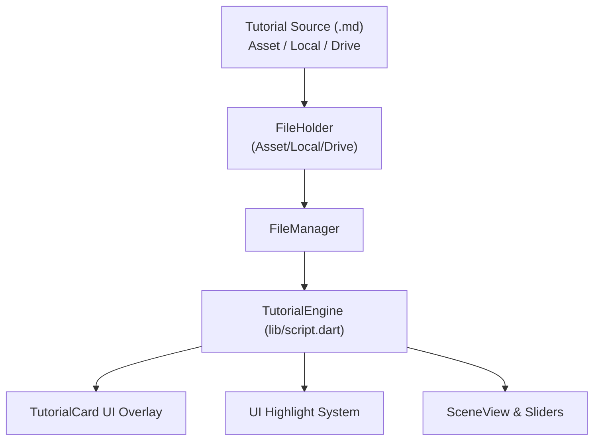
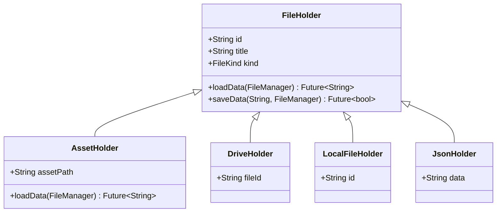

# Spacetime Tutorials Plan

Interactive tutorials help users learn to use the Spacetime Drawing Tool and
explore the core concepts of special relativity through hands-on guidance.

The user will be able to select from built-in tutorials or load custom
tutorials from local storage, Google Drive, or the clipboard.

______________________________________________________________________

## 1. High-Level Vision & Architecture

Tutorials are stored as readable Markdown files. Each tutorial consists of
sequential steps that provide explanatory text alongside interactive prompts.



### Core Architecture Components

- **`FileHolder` & `FileManager` Integration**: Generalize `FileHolder` to
  support both scenes (JSON) and tutorials (Markdown). Provide `AssetHolder`
  for offline built-in tutorials.

- **`TutorialEngine` (`lib/script.dart`)**: Parses Markdown tutorial files into
  structured step models, listens to scene/slider changes, checks exit
  criteria, and manages step transitions.

- **`TutorialCard` UI Overlay**: A floating, non-intrusive card that renders
  the current step's Markdown instructions, progress indicator, and action
  controls.

- **Target Highlighting System**: Visually accents the specific UI control or
  slider the user needs to interact with for the active step.

______________________________________________________________________

## 2. Syntax & Directives: Combined Highlight & Exit

To make authoring concise and human-friendly, directives in tutorial Markdown
use blockquotes (`>`).

**Combined Directives**: Specifying a target state automatically sets both the
**highlight target** and the **exit criterion**.

```markdown
> velocity = 0.25
```

This single line instructs the engine to:

1. **Highlight** the observer velocity slider.
1. **Wait for exit**: trigger step completion when the observer velocity
   reaches `0.25` within default tolerance.

### Built-in Directives & Default Tolerances

- `> v = 0.25` or `> velocity = 0.25`: Highlights velocity slider; exits when
  observer velocity reaches target (default tolerance $\pm 0.02$).

- `> t = 2.0` or `> time = 2.0`: Highlights time slider; exits when observer
  time reaches target (default tolerance $\pm 0.1$).

- `> mode = ether` or `> ether`: Highlights light speed menu; exits when Ether
  mode is selected.

- `> lorentz`: Highlights light speed menu; exits when Lorentz mode is
  selected.

- `> ok` or `> next`: Highlights "Continue" button on the card; exits on click.

- `> setup: <actions>`: Programmatically sets scene state (e.g.,
  `v=0, t=0, mode=lorentz`). Exits immediately without user interaction.

- `> reset`: Clears the canvas to a clean baseline state. Exits immediately
  without user interaction.

### Custom Tolerance Override

Authors can optionally override default tolerances directly on numeric
directives when finer or coarser precision is needed:

```markdown
> v = 0.25 tol=0.005
> t = 5.0 tol=0.5
```

### Setup Directives

When a step requires preparing the drawing without requiring the student to
manually build it, a `setup:` directive configures the scene state at the start
of that step:

```markdown
> setup: v=0, t=0, mode=lorentz
> setup: load="assets/scenes/train_and_light.json"
```

______________________________________________________________________

## 3. Sample Tutorial Script

Here is an example tutorial using the combined syntax:

```markdown
# Speed of Light in Moving Frames

Learn how light behaves under different physical assumptions.

## Step 1: Start Fresh
Welcome! Let's start with a clean diagram and look at our sliders.

> reset
> setup: v=0.0, t=0.0, mode=lorentz
> ok

## Step 2: Set Observer Velocity
At the bottom of the screen is the velocity slider. Set the velocity
to 0.25 to see the reference frame tilt.

> v = 0.25

## Step 3: Add Light Ray
Let's observe how light travels. Notice the yellow light cone in the
diagram. Even though the observer moves at v = 0.25, the light ray's
speed remains exactly 1.0!

> setup: load="assets/scenes/light_pulse.json"
> ok

## Step 4: Examine the Ether Hypothesis
Before relativity, physicists thought light traveled through a medium
called the ether. Switch the light speed model to Ether.

> mode = ether

## Step 5: Test Relative Light Speed
Adjust the velocity back to 0 to return to the ether's rest frame.
Notice that the rays only travel at speed 1 when at rest relative to the
ether!

> v = 0.0
```

______________________________________________________________________

## 4. Storage, Bundling & File Management Integration

Tutorials need to be easily accessible without requiring login, while also
allowing users and educators to create, share, and open custom tutorials.

### Bundled Built-in Tutorials (No Login Required)

- Built-in tutorials are stored in the app asset bundle:
  `assets/tutorials/*.md`.

- The asset directory is declared in `pubspec.yaml` and bundled into both the
  Web and Android builds.

- An asset manifest or registry lists available built-in tutorials:

  - `01_speed_of_light.md`: Light speed constancy across frames.
  - `02_time_dilation.md`: Moving clocks run slow.
  - `03_length_contraction.md`: Moving rulers contract.
  - `04_barn_pole_paradox.md`: Simultaneity and the barn-pole paradox.

- Users can open any built-in tutorial directly from the dedicated "Tutorials"
  section in the drawer or top menu bar without logging in.

### Tweaking `FileHolder` & `FileManager`

We can generalize [`FileHolder`](lib/file_holder.dart) and
[`FileManager`](lib/file_manager.dart) to seamlessly support both scene JSON
and tutorial Markdown documents:



1. **`FileKind` Enumeration**: Add an explicit kind to `FileHolder`:

   - `FileKind.scene` (standard spacetime drawings, `.sp` / `.json`).
   - `FileKind.tutorial` (interactive tutorial lessons, `.md` / `.sptut`).

1. **`AssetHolder` Implementation**: A concrete `FileHolder` that loads text
   assets via `rootBundle.loadString(assetPath)`. Read-only, requires no
   network or auth.

1. **Drive & Local File Compatibility**:

   - [`DriveHolder`](lib/drive.dart) and
     [`LocalFileHolder`](lib/local_file.dart) already load and save arbitrary
     text strings.
   - By associating `FileKind`, `FileManager` can filter file pickers to either
     drawings or tutorials.

1. **Scene Stashing & Session Safety**:

   - When launching a tutorial, `FileManager` checks if the current scene has
     unsaved changes.
   - If clean (or after user saves), the active scene is stashed in memory.
   - While the tutorial is active, the scene view operates in a tutorial
     sandbox.
   - When the user exits or finishes the tutorial, the stashed user scene is
     restored cleanly.

______________________________________________________________________

## 5. Tutorial UI & Interaction Design

The tutorial interface must be clear, responsive, and avoid blocking the
interactive canvas or the sliders.

### Tutorial Overlay Card (`TutorialCard`)

```
+-------------------------------------------------------------+
| [TUTORIAL] Speed of Light in Moving Frames     [Reset] [X]  |
| Step 2 of 5: Set Observer Velocity                          |
| [========================---------------------------------] |
+-------------------------------------------------------------+
| Move the observer velocity slider at the bottom to 0.25.    |
| Notice how the coordinate grid tilts under the Lorentz      |
| transformation.                                             |
+-------------------------------------------------------------+
| [Target: v = 0.25  | Current: v = 0.12]                     |
| [< Back]                                       [Continue >] |
+-------------------------------------------------------------+
```

### Component Details

- **Card Positioning**:

  - **Desktop / Wide Layout**: Docked in the upper right corner of the main
    workspace, floating over the canvas with subtle shadow. Can be dragged or
    collapsed by the user if it covers an area of interest.
  - **Mobile / Narrow Layout**: Compact panel pinned between the main canvas
    and the sliders, with an expandable drawer for longer explanations.

- **Header**:

  - Tutorial title and step badge (`Step 2 of 5`).
  - Linear progress bar indicating completion percentage.
  - **Reset Step Button**: Reapplies the step's initial baseline setup if the
    user gets confused or makes unintentional scene changes.
  - **Close Button ($X$)**: Prompts confirmation to exit tutorial mode and
    returns to normal drawing.

- **Body Content**:

  - Formatted Markdown text (rendered with Flutter `markdown` widget).
  - Supports bullet points, emphasis, and math symbols.

- **Live Feedback Status**:

  - Shows target vs current state in real time: e.g.,
    `Target: v = 0.25 | Current: 0.10`.
  - When criteria are met, the badge flashes green: `✓ Target reached!`.
  - A brief delay (400–600ms) gives the user satisfying visual feedback before
    advancing to the next step.

- **Navigation**:

  - `< Back`: Returns to the previous step and restores its baseline setup.
  - `Continue >`: Active for informational steps (`> ok`), or allows manual
    advance if the user wants to skip.

### UI Highlighting System

- **Highlight Target Registry**: Interactive controls register their target
  IDs:

  - `slider.velocity` $\rightarrow$ Velocity slider row.
  - `slider.time` $\rightarrow$ Time slider row.
  - `menu.light_speed` $\rightarrow$ Light speed model menu / dropdown.
  - `tutorial.continue` $\rightarrow$ "Continue" button on the tutorial card.

- **Visual Effect**:

  - When highlighted, the target widget displays an animated pulsing border or
    glowing accent outline (using the theme's secondary or accent color).
  - When criteria are satisfied, the pulse transitions to a steady green check
    glow before advancing.

______________________________________________________________________

## 6. Proof of Concept (PoC) Plan

The goal of the Proof of Concept is to validate the core loop: loading a
bundled tutorial Markdown asset, parsing combined directives, highlighting a
slider, detecting exit criteria, and progressing through steps.

### PoC Scope Boundaries

1. **Parser (`lib/script.dart`)**:

   - Parse Markdown into a `Tutorial` model containing a list of `TutorialStep`
     objects.
   - Parse combined directives:
     - `> v = <number>` / `> velocity = <number>` (default $\pm 0.02$ tol).
     - `> t = <number>` / `> time = <number>` (default $\pm 0.1$ tol).
     - `> ok` / `> next` (advances on button tap).
     - `> reset` (clears drawing).

1. **File Loading (`AssetHolder`)**:

   - Add `AssetHolder` to `lib/file_holder.dart`.
   - Bundle a 4-step tutorial at `assets/tutorials/speed_of_light.md`.

1. **Overlay & Highlight UI**:

   - Create `TutorialCard` in `lib/widget.dart` (or
     `lib/tutorial_widget.dart`).
   - Add highlight wrapper around the velocity and time sliders.

1. **Test Suite**:

   - Unit tests for directive parsing and tolerance math in
     `test/script_test.dart`.
   - Widget test verifying tutorial step advancement in
     `test/tutorial_test.dart`.

______________________________________________________________________

## 7. Future Enhancements (Post-PoC)

- Relational entity criteria (e.g. checking position of objects in canvas).
- Canvas reticle overlays pointing to specific drawing entities.
- Google Drive file picker filtering for `.md` / `.sptut` tutorial files.
- Authoring mode / in-app tutorial editor.
